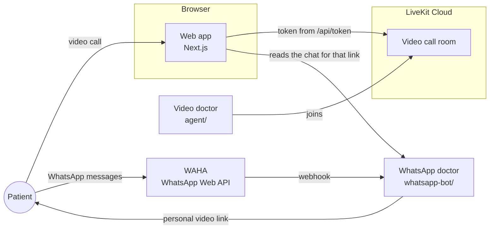

# doctor.ai

An AI doctor that patients reach on WhatsApp or on a live video call in the browser. It takes a history the way a family physician would, looks at the problem on camera, explains what is most likely going on in plain language, and tells the patient what to do next. It speaks Urdu, Roman Urdu, English, Punjabi and other Pakistani languages.

In an emergency it tells the patient to call 1122 and names the nearest hospitals, with directions.

## What's in it

- **Web app** (Next.js): landing page, a short intake form, and the live video consult with a 3D doctor avatar.
- **Video doctor** (Python, LiveKit Agents): talks and listens in real time on Gemini Live and sees the patient's camera. It can look up medical guidance from trusted sources, and in an emergency it finds the hospitals nearest the patient.
- **WhatsApp doctor** (Python, FastAPI, WAHA): answers text, photos and voice notes on WhatsApp. When something needs a closer look, it sends the patient a personal link to a video consult that already knows the conversation.
- **Promo films** (`motion/`): HyperFrames sources for the product videos on the landing page.

## How it fits together



1. The patient fills in their name, WhatsApp number and a line about their health. It stays in their browser's local storage.
2. Starting a video consult asks the app's `/api/token` route for a LiveKit token. The patient's notes go with it as the `saathi.brief` participant attribute.
3. LiveKit sends the video doctor into the room. It reads the notes, greets the patient by name and starts the consult.
4. Once the call starts, the browser asks to share the patient's location. If they allow it, the location goes to the agent as the `saathi.location` attribute, ready for an emergency.
5. Links the doctor wants to show, such as sources or nearby hospitals, are posted to the call's chat and appear as a card on screen.

## Repository layout

```text
app/                    Next.js routes
  api/token/route.ts      Issues LiveKit tokens (development only, see Deploying)
  start/                  Intake form and choosing WhatsApp or video
  consult/video/          The live video consult
  video/                  Where WhatsApp video links land
  consult/, dashboard/    Redirects from older links
components/saathi/      UI: landing page, consult screen, 3D avatar
lib/                    Patient store (localStorage) and the brief sent to the doctor
public/                 Avatar model, images, landing page films
agent/                  Video doctor (Python)
  agent.py                Agent, tools and model fallbacks
  saathi_prompt.md        The doctor's instructions
  medical_search.py       look_up_medical_guidance tool
  nearby_hospitals.py     find_nearby_hospitals tool
whatsapp-bot/           WhatsApp doctor (Python), with its own README
motion/                 HyperFrames sources for the promo films
scripts/avatar/         Script that prepared the avatar model
```

## Prerequisites

- Node.js 24 and pnpm 9 (`corepack enable` installs the right pnpm)
- [uv](https://docs.astral.sh/uv/) for the video doctor. It installs Python 3.12 for you.
- A [LiveKit Cloud](https://cloud.livekit.io) project (the free tier is fine)
- A Gemini API key from [Google AI Studio](https://aistudio.google.com/apikey)
- For the WhatsApp doctor only: Python 3.9+, Docker, an [OpenRouter](https://openrouter.ai/keys) key and a spare WhatsApp number

## Run it locally

You need two terminals for the video consult, and two more for the WhatsApp doctor.

### 1. Get LiveKit credentials

In your LiveKit Cloud project, open **Settings → API keys** and create a key. Note the WebSocket URL (`wss://<project>.livekit.cloud`), the API key and the API secret. The web app and the agent both use them.

### 2. Start the web app

```bash
pnpm install
cp .env.example .env.local
```

Fill in `.env.local`:

```env
LIVEKIT_URL=wss://<project>.livekit.cloud
LIVEKIT_API_KEY=<api key>
LIVEKIT_API_SECRET=<api secret>
```

Then run it:

```bash
pnpm dev
```

The app is at http://localhost:3000.

### 3. Start the video doctor

```bash
cd agent
cp .env.example .env
```

Fill in `agent/.env` with the same three LiveKit values and your `GOOGLE_API_KEY`. The other keys are optional (see [Environment variables](#environment-variables)). Then:

```bash
uv sync
uv run agent.py download-files   # once: downloads the voice activity model
uv run agent.py dev
```

Wait for `registered worker` in the output.

### 4. Try a consult

Open http://localhost:3000, choose **Start a consult**, enter a name and number, and pick **Video consult**. Allow the camera, microphone and location when the browser asks. The doctor greets you by name within a few seconds.

To try the emergency flow, tell it you have crushing chest pain spreading to your arm. It should tell you to call 1122, name the closest hospitals and show them on screen with directions.

> Browsers only share the camera, microphone and location on `https` pages or `localhost`. To test on a phone, use a tunnel such as `ngrok http 3000` or deploy the app.

### 5. Optional: the WhatsApp doctor

Follow [`whatsapp-bot/README.md`](./whatsapp-bot/README.md). To connect it to the web app:

- Set the same random `HANDOFF_SECRET` in `whatsapp-bot/.env` and in the web app's `.env.local`.
- Set `SAATHI_WHATSAPP_NUMBER` in `.env.local` to the bot's number, digits only with the country code (for example `923001234567`).
- Set `VIDEO_CALL_URL` in `whatsapp-bot/.env` to where the web app runs, such as `http://localhost:3000`.

Restart `pnpm dev` after changing `.env.local`.

## Environment variables

### Web app (`.env.local`)

| Variable                                               | Required     | What it's for                                                                                    |
| ------------------------------------------------------ | ------------ | ------------------------------------------------------------------------------------------------ |
| `LIVEKIT_URL`, `LIVEKIT_API_KEY`, `LIVEKIT_API_SECRET` | Yes          | Signing tokens for video calls                                                                   |
| `AGENT_NAME`                                           | No           | Leave blank so LiveKit sends any running agent. Set it only if the agent registers under a name. |
| `SAATHI_WHATSAPP_NUMBER`                               | For WhatsApp | The bot's number, digits only. Without it the start page shows WhatsApp as unavailable.          |
| `HANDOFF_SECRET`                                       | For WhatsApp | Shared with the bot so video links from WhatsApp can read the chat                               |
| `WHATSAPP_BOT_URL`                                     | No           | Where the bot runs. Defaults to `http://localhost:8000`.                                         |

### Video doctor (`agent/.env`)

| Variable                                                     | Required    | What it's for                                                                                                                                                            |
| ------------------------------------------------------------ | ----------- | ------------------------------------------------------------------------------------------------------------------------------------------------------------------------ |
| `LIVEKIT_URL`, `LIVEKIT_API_KEY`, `LIVEKIT_API_SECRET`       | Yes         | Joining calls                                                                                                                                                            |
| `GOOGLE_API_KEY`                                             | Yes         | Gemini Live (voice and camera) and medical lookups                                                                                                                       |
| `DEEPGRAM_API_KEY`                                           | Recommended | Speech-to-text and text-to-speech if every realtime model fails                                                                                                          |
| `OPENROUTER_API_KEY`                                         | Recommended | The language model for that same fallback                                                                                                                                |
| `GOOGLE_MAPS_API_KEY`                                        | Recommended | Nearby hospitals from Google Places. Needs a Google Cloud key with **Places API (New)** enabled; AI Studio keys don't work. Without it, free OpenStreetMap data is used. |
| `SAATHI_LIVE_MODELS`, `SAATHI_PIPELINE_LLMS`, `SAATHI_VOICE` | No          | Override the models and fallback order. See `agent/.env.example`.                                                                                                        |

### WhatsApp doctor (`whatsapp-bot/.env`)

See [`whatsapp-bot/README.md`](./whatsapp-bot/README.md).

## How the doctor works

**Instructions.** The video doctor's behaviour lives in [`agent/saathi_prompt.md`](./agent/saathi_prompt.md): emergency screening first, then history, camera exam, reasoning and a plan, ending with when to see a doctor in person and which warning signs mean going to the emergency department. It states its assessment with confidence. It doesn't name medicines or doses or order tests; it says what kind of treatment helps and leaves the choice to a doctor or pharmacist. The WhatsApp doctor's instructions are `INSTRUCTIONS` in [`whatsapp-bot/main.py`](./whatsapp-bot/main.py).

**Looking things up.** `look_up_medical_guidance` searches the web with Gemini's Google Search grounding. On keys where that isn't available, it falls back to MedlinePlus and FDA drug labels. The doctor names the source out loud and the links appear on screen.

**Nearby hospitals.** `find_nearby_hospitals` uses the location the browser shared, or an area the patient names, such as "Gulberg, Lahore". It returns the five nearest hospitals within 15 km, ranking general hospitals above clinics, labs and single-specialty hospitals. Results come from Google Places when `GOOGLE_MAPS_API_KEY` is set, otherwise from OpenStreetMap. Each hospital on screen links to Google Maps directions.

**Staying up.** The realtime models are tried in order (`SAATHI_LIVE_MODELS`), ending on one billed through LiveKit Inference, so calls keep working if the Gemini quota runs out. If every realtime model fails, the call carries on as a speech-to-text, LLM and text-to-speech pipeline without the camera.

## Checks

```bash
pnpm lint            # ESLint
pnpm format:check    # Prettier
pnpm build           # production build

cd whatsapp-bot && python test_main.py   # WhatsApp bot, offline, no keys needed
```

GitHub Actions runs the first three on every push and pull request to `main`.

## Deploying

- **Web app:** deploy to Vercel or any Node host, with the web app's environment variables. `app/api/token/route.ts` hands a token to anyone who asks, so it refuses to run in production (`NODE_ENV=production`) unless `IS_VERCEL_PREVIEW=true`. Put it behind your own login, or replace it, before going live.
- **Video doctor:** run `uv run agent.py start` on any server with `agent/.env`, or deploy it to LiveKit Cloud with `lk agent create` from the `agent/` folder.
- **WhatsApp doctor:** see [`whatsapp-bot/README.md`](./whatsapp-bot/README.md). WAHA links the number the way WhatsApp Web does, which is against WhatsApp's terms, so use a spare number.

## Troubleshooting

- **"doctor.ai couldn't join the call":** the agent isn't running, or it uses a different LiveKit project from the web app. Check that `uv run agent.py dev` shows `registered worker` and that both `.env` files have the same `LIVEKIT_URL`.
- **The doctor never mentions hospitals or asks where you are:** the browser didn't share a location. Check the site's location permission, and that the page is on `https` or `localhost`.
- **Hospital lookups are slow or empty:** the free OpenStreetMap servers are sometimes busy. Set `GOOGLE_MAPS_API_KEY` for reliable results.
- **Camera or microphone blocked:** allow them in the browser's site settings and reload.

## Credits and license

Built on LiveKit's [agent-starter-react](https://github.com/livekit-examples/agent-starter-react) template. Released under the MIT license; see [LICENSE](./LICENSE).
